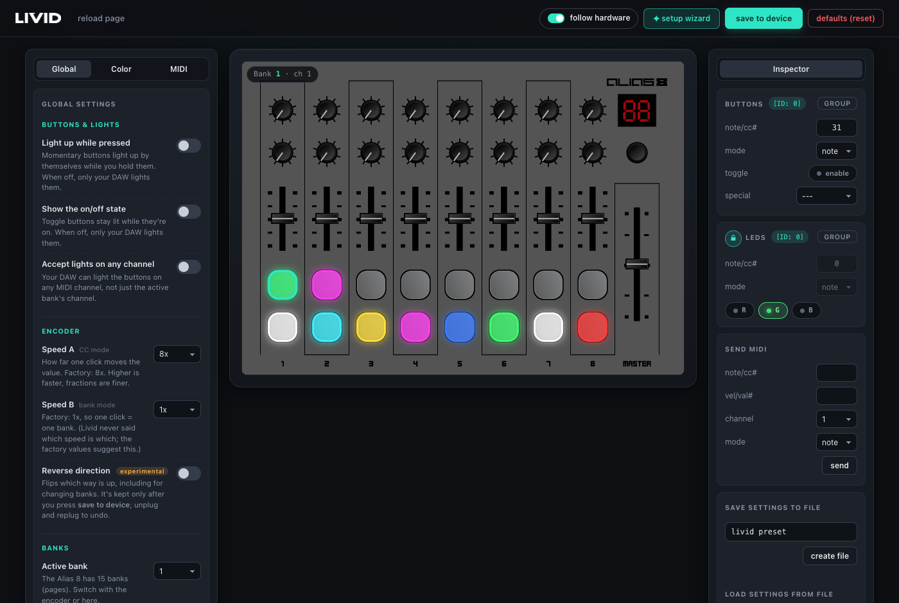
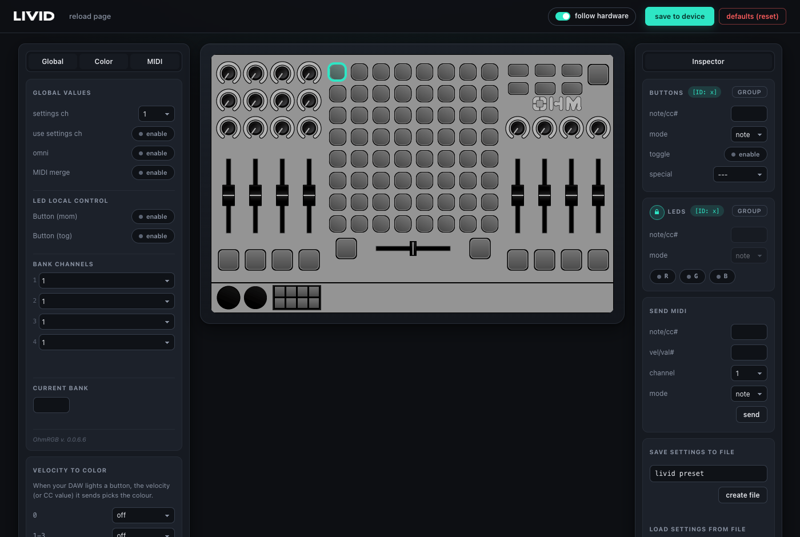
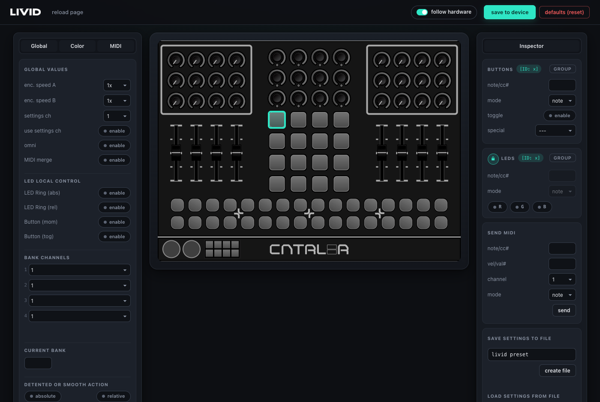
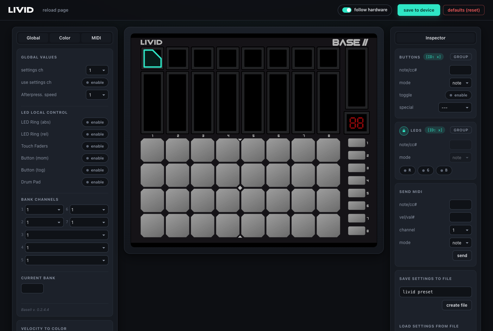
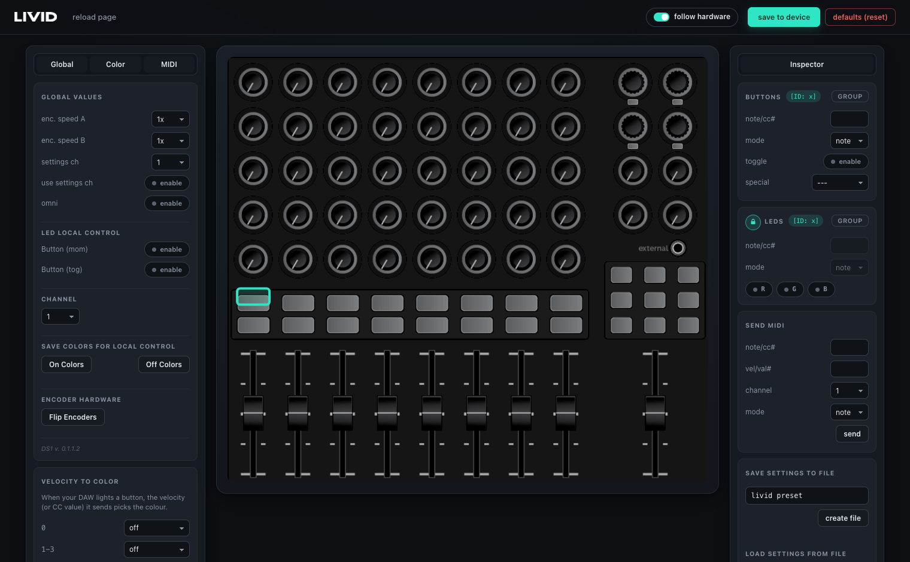
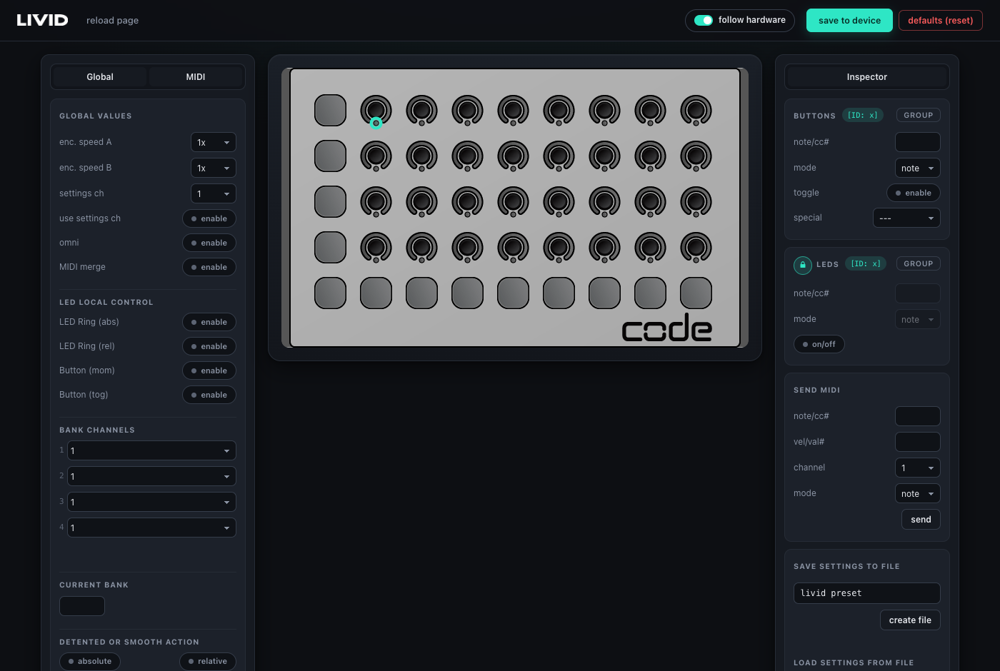

# Livid Editor (updated)

A browser editor for **Livid Instruments** MIDI controllers: set what every knob, fader, button and encoder sends, the LED colours, banks and global settings, and save it to the controller or to a preset file. It talks to the controller directly over Web MIDI (system exclusive) – no driver, no plug-in, no internet connection.

This is an updated version of Livid's own online editor. Livid Instruments is no longer in business and the original editor is no longer hosted, so this repo keeps it working in today's browsers and fixes a number of bugs.

<table>
  <tr>
    <td> OhmRGB</td>
    <td> CNTRL:R</td>
  </tr>
  <tr>
    <td> Base II</td>
    <td> DS1</td>
  </tr>
  <tr>
    <td> Code</td>
    <td></td>
  </tr>
</table>

The Alias 8 shows one of the presets in `Presets/`. The other models are shown with an empty setup: the screenshots were made without the hardware, so their buttons are unlit and the settings are blank until a real controller answers.

## Which controllers

| Controller | Status |
|---|---|
| **Alias 8** | Tested with real hardware. Also has the setup wizard and a reorganised Global panel. |
| Ohm64, OhmRGB, Code, Base, Base II, block, CNTRL:R, DS1 | Supported (faceplate and all settings), **not tested** with this version. |
| Brain, Brain v2, Brain Jr., BrainCV, Guitar Wing | Recognised, but not editable – the original editor didn't support them either (the Brains are DIY boards without fixed controls). |
| Enlighten, MCP, MCDAW | Not supported. |

The fixes in this version (MIDI connection, reading and writing settings, presets) apply to every model, so the other controllers should work at least as well as with the original editor. If you try one, please open an issue and say how it went – working or not.

## Starting it

- **Chrome / Edge:** open `Livid Editor.html` and allow MIDI / system exclusive access when asked.
- **Firefox:** Firefox only allows MIDI from pages served on your own computer. On a Mac, double-click `Start editor (Firefox).command` (it serves http://localhost:8642 and opens Firefox). On other systems, run `python3 -m http.server 8642` in this folder and open http://localhost:8642/Livid%20Editor.html.
- **Safari:** no Web MIDI support.

Connect the controller first, then open the editor; pick its port if it isn't found automatically. Settings are read from the controller one by one (a progress bar shows it). Changes are sent right away; press **Save to device** to keep them after unplugging.

## Is it safe?

The editor only changes **settings** – what each control sends, LED colours, banks, channels – using the same system-exclusive commands as Livid's own editor. It never touches the **firmware**: it has no firmware updater and doesn't talk to the controller's bootloader. So it can't turn a controller into a brick, but a bad setting can make it *look* dead (no lights, every knob on the same CC, banks on unexpected channels). That's always recoverable:

- **Before you change a lot:** save the current settings with **create file** (the setup wizard makes a backup for you).
- **Changes are temporary until you press Save to device.** If something looks wrong and you haven't saved, unplug the controller and plug it back in.
- **To go back to factory settings:** press **defaults (reset)** – it sends the controller's own factory-reset command. Or load your backup with **Choose File** and press **Save to device**.
- **Don't unplug the controller while it is saving** (right after Save to device or a reset).
- **Reverse encoder direction** in the Alias 8 Global panel is experimental (an undocumented command); it is only stored if you press Save to device.

Models other than the Alias 8 haven't been tested with this version (see the table above), but they use the original editor's code for reading and writing their settings.

## Setup wizard (Alias 8 only)

The **Setup wizard** button sets up the whole Alias 8 in a few steps: knob/fader CC numbers, button notes and behaviour, LED colours per row, bank channels and the encoder. It can write the setup to one bank, banks 1–5 or all 15, and saves a backup preset first. Templates:

- **Sequential** – the Alias 8 factory layout: knobs and faders CC 1–25, buttons notes 0–15.
- **DAW-friendly** – CCs that no instrument uses by default (102–117, 20–28), so MIDI-learn never clashes; buttons notes 36–51 for drum racks.
- **For the Alias8_Live script** – only needed if you use [alias8-scribble](https://github.com/nygardsvulkanen/alias8-scribble), a control surface script for Ableton Live 12. It sets exactly what that script expects (see below). For any other use – another DAW, Live's own MIDI mapping, hardware synths – pick one of the other templates.
- **Current settings** – start from what the controller has now.

What the Alias8_Live template sets: factory numbering (CC 1–25, notes 0–15), momentary buttons, banks 1–15 on MIDI channels 1–15 written to all 15 banks, the encoder turning to change bank plus its CC mode on CC 42 (relative), a colour map where the button velocity picks the colour (1 red, 4 green, 8 yellow, 16 blue, 32 pink, 64 cyan, 127 white), and local LED control off so the script lights the buttons.

## Presets

`Presets/` holds the author's own preset files (colour setups and GR-1 / Ableton layouts) as examples. Load one with **Choose File**; the editor refuses a preset made for another model. Save your own with **create file**.

## What's in the folder

- `Livid Editor.html` – the editor (open this)
- `Start editor (Firefox).command` – starts it in Firefox on a Mac
- `app/` – the editor's code, styles and faceplate pictures (keep it next to the page)
- `Presets/` – preset files
- `Docs/` – a longer read-me, the change list (`CHANGES.md`) and notes on how the code works

## License

MIT for the changes in this repo – see `LICENSE`. Based on the Livid Online Editor by Livid Instruments (no longer in business); third-party libraries (jQuery, jQuery UI, Raphael, tag-it, KineticJS …) and the font keep their own licenses.
